

  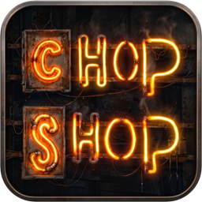

<h1 align="center">Chop Shop</h1>

<b>Chop any sample. Play it on pads. Finish the song in LUNA.</b>

  <a href="https://github.com/garrettz/chop-shop/releases/latest"><b>Download</b></a> ·
  <a href="#install">Install</a> ·
  <a href="https://www.youtube.com/watch?v=hiP7GBm7hJo">Take a tour with Glitchy ▶</a> ·
  <a href="https://lowdownsound.io/chop-shop">Website</a> ·
  <a href="https://lowdownsound.io/store">Skill packs</a>

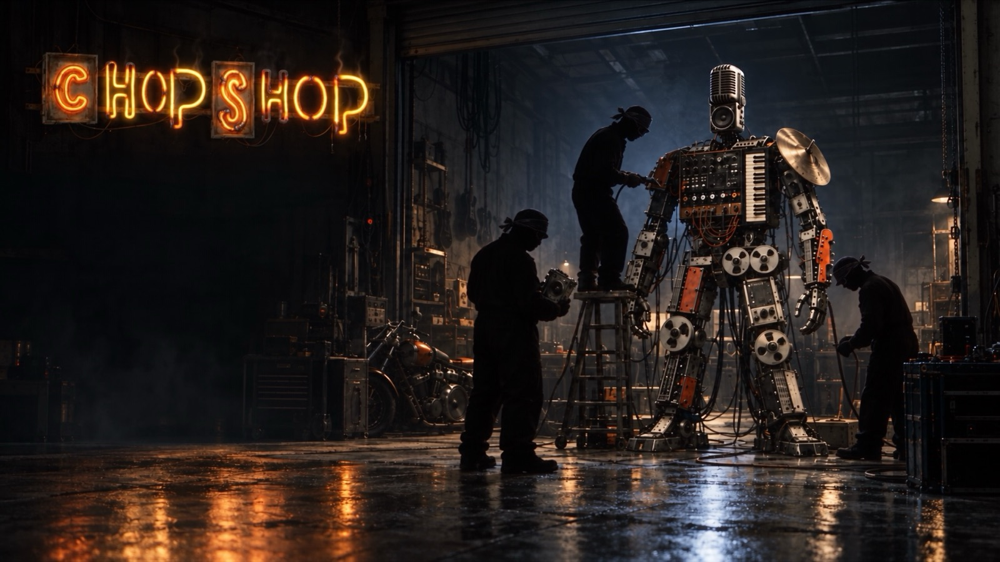

Chop Shop is a sampler and beat machine that lives inside LUNA. It cuts samples into hits, plays them on a step grid,
and writes every hit into your session as real tracks and clips.

- **Version 0.4.37**, built on `@uaudio/luna-builder-sdk` 3.1.2.63
- **Needs** LUNA 3.1.1 or later, on macOS
- **Three example packs** to start, or **bring your own samples**

https://github.com/user-attachments/assets/172158d0-3a1f-4104-b723-2bf487173056

Pick a pack, press Generate, and a song plays (27 s, sound on).

## Watch it

### [▶ Take a tour with Glitchy](https://www.youtube.com/watch?v=hiP7GBm7hJo)

The full tour on YouTube: Glitchy shows you round the shop, from a pack to a finished song.

[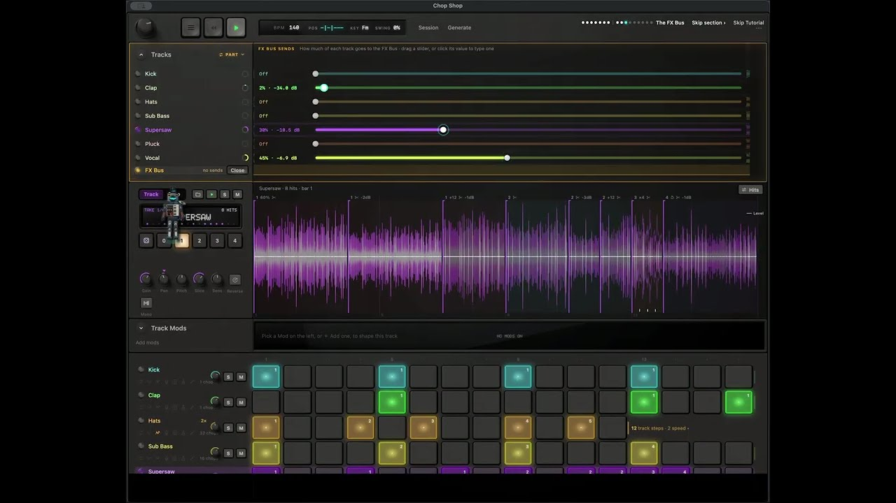](https://www.youtube.com/watch?v=hiP7GBm7hJo)

### Feature clips

Click a picture to play the video with sound (it opens on lowdownsound.io). The same videos are in
[`docs/video/`](docs/video).

| | |
|---|---|
| [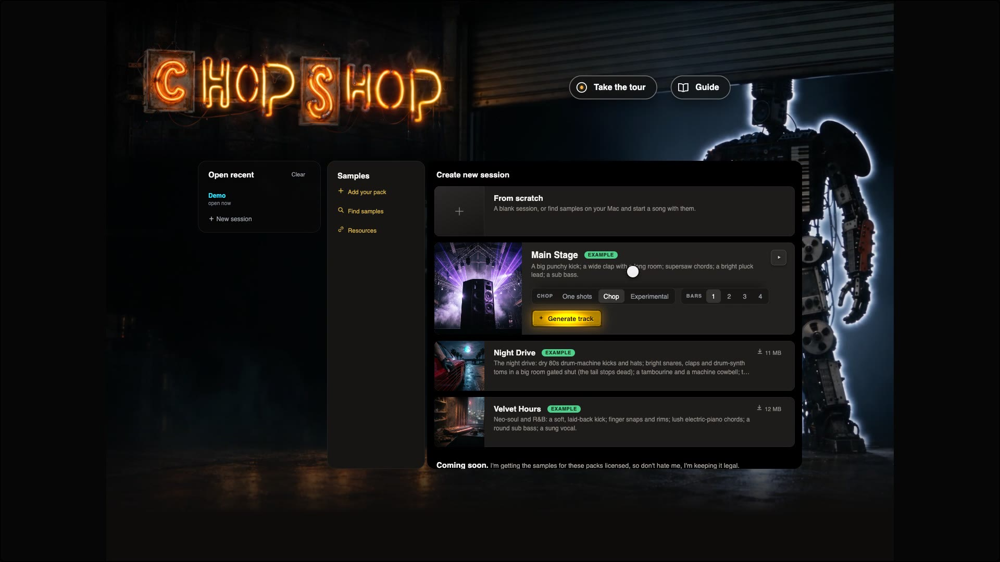](https://lowdownsound.io/site/clips/generate.mp4) **Generate** · Pick a pack, press Generate, and a song plays (27 s) | [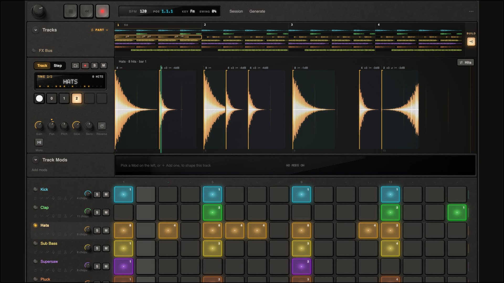](https://lowdownsound.io/site/clips/takes.mp4) **Takes** · Roll the dice until it grooves (42 s) |
| [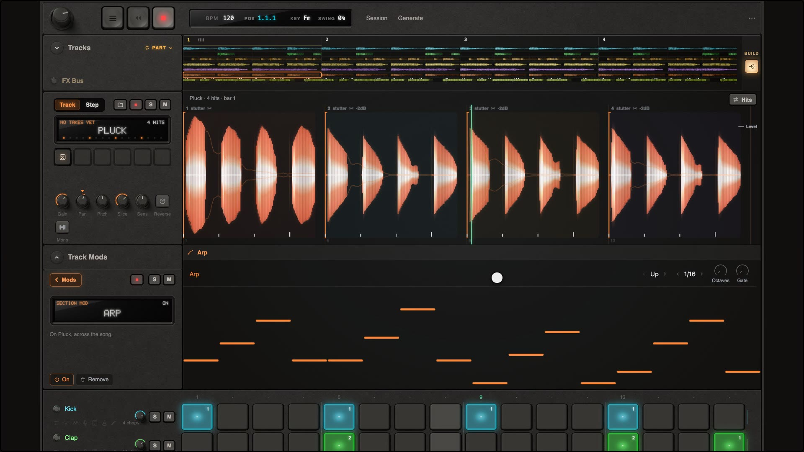](https://lowdownsound.io/site/clips/mods.mp4) **Mods** · Tone, space and movement (40 s) | [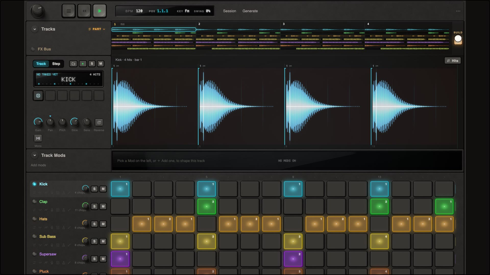](https://lowdownsound.io/site/clips/build.mp4) **Build** · Grow a loop into a song (45 s) |
| [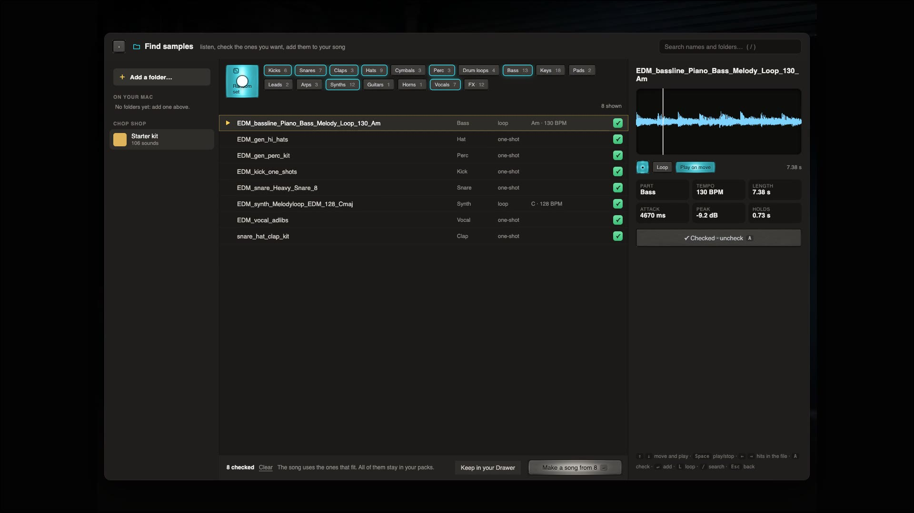](https://lowdownsound.io/site/clips/own-sounds.mp4) **Your own sounds** · A folder of samples becomes a pack (31 s) | |

## How a track gets made

From a folder of sounds to a song, in five moves.

1. **Pick a pack.** Open an example pack, start from scratch, or add a folder of your own samples.
2. **Generate.** Pick 1 to 4 bars and press Generate. Chop Shop writes the parts in the pack's genre.
3. **Roll takes.** Press the dice for a new riff from the same chops. Keep the one that grooves.
4. **Shape it.** Gain, pan and pitch, then Mods for tone, space and movement.
5. **Build the song.** Swells, drops, breaks, intros and outros, one move at a time.

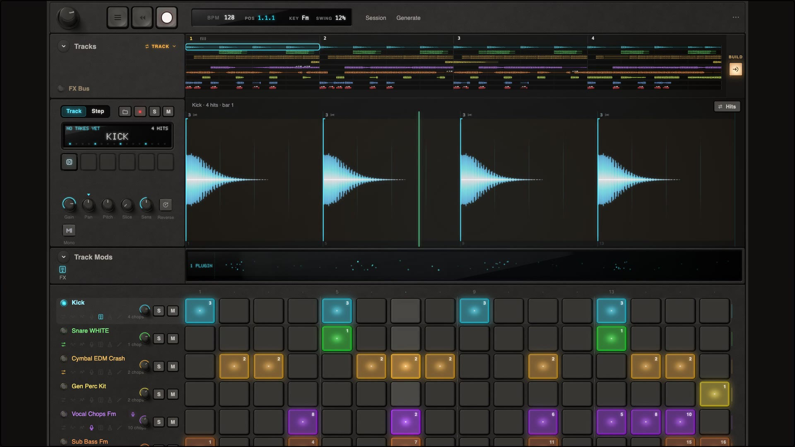

## Takes: roll it until it grooves

Every roll of the dice is a new riff played from the same chops. Keep the take you like, roll again when you don't.
Single hits get their own takes too.

- **Every roll is kept:** go back to any take, or to the one you started with.
- **Long samples get cut-up takes:** the loop is cut at its hits and comes back as a new riff, a melody in key, or a rhythm.
- **On a vocal,** the dice writes a melody from its syllables, in key.

## Skills: Generate with a producer's habits

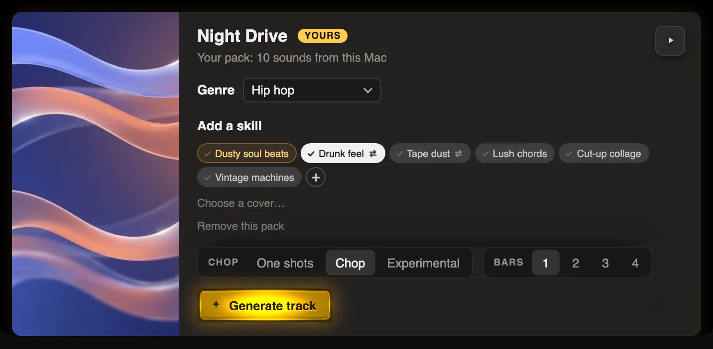

Skills are producer traits, two or three words each. Tick one or two and Generate writes the track with that feel: its
timing, levels, rolls, grit, space and pump.

- **Drunk feel**, **Tape dust**, **Lush chords**, **Cut-up collage** and dozens more. Hover one to see what it does.
- **Blends** do several at once; some step along a scale, from machine tight to swung to drunk.
- **A skill brings its part:** tick a vocal skill and the kit gets a vocal track.

Skills come with your own packs for now. The example packs play as written.

 

## Mods: where the magic happens

Add a Mod to a track and it opens as a lane under the pads. Effects are LUNA's own plugins, so what you hear is what
your session plays.

**EQ · Modulation · Effects · Synthesis · Automation · Melody · Arp · Stutter**

### Synthesis: turn a chop into a synth

The Synthesis Mod plays every hit through a synth built from the chop itself. Pick two shapes and it moves from one to
the other, bar by bar, so every hit comes out a little different.

Wavetable · Resonator · FM · Analog · Vocoder · String · Phase Dist · Granular

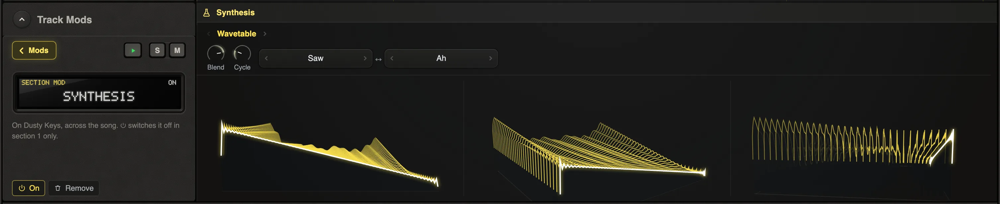

## Chance and drift: a loop that never plays the same twice

Leave some of it to chance, the way a modular rig does. Nothing here is a random button: you choose how loose it gets.

- **Chance:** how likely a hit is to play, rolled again on every pass.
- **Every:** a hit that plays 1 pass in 4, only the first time, only in fills, or only if the hit before it played.
- **Track length:** drag a track's end in. Hi-hats at 12 steps against a 16-step bar come round again every three
  bars, and the groove keeps shifting.
- **Even hits** spreads a track's hits evenly over its length, **Rotate** slides them round, and **Speed** runs it at
  half to double time.
- **Experimental** Generate does all of this for you: chopped hard, odd lengths, hits that play on some passes only.

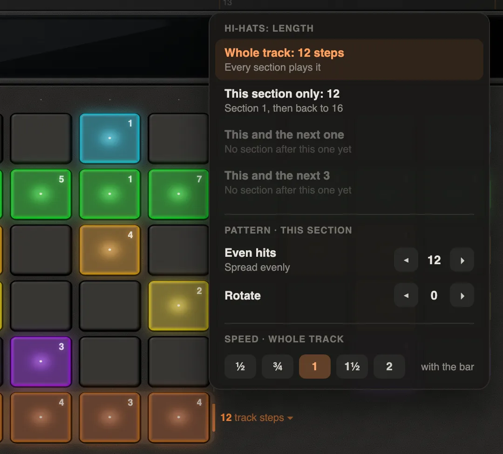

## One hit: rolls, stutters and bends

Pick any hit and go to Step. It gets its own takes, its own chop, and Mods of its own on top of the track's.

- **Split** divides a step into 2, 3, 4 or 6 fast hits, or a flam, and can walk them up or down.
- **Stutter:** a quick run on the chop, a breath, then a landing that opens into the reverb.
- **Repeat**, **Bend**, and locks for **Filter**, **Grit** and **Space** on that hit only.
- **Trim:** double-click a hit to set where it starts and stops, even past its chop into the rest of the sample.

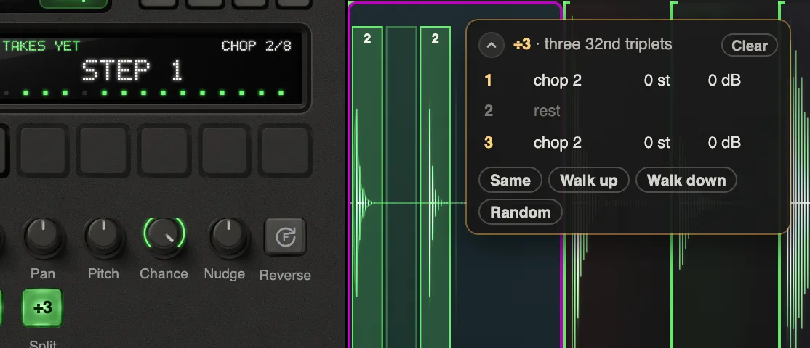

## Build: grow a loop into a song

Build writes new bars after the part you're on. Pick a move, roll its takes, preview it in the page, and press Insert
when it's right. Nothing reaches LUNA until you do.

| Lift | Peak | Space | Ends |
|---|---|---|---|
| Swell · Fill · Pull | Chorus · Drop | Break · ½ Time | Intro · Outro |

## Made for LUNA: everything lands in your session

Play is LUNA's own Play, through LUNA's mixer. Your plugins, faders and bounces work as usual.

- **Real tracks and clips.** Each track is an audio track called Chop 1, Chop 2… and each hit is a clip on it.
- **LUNA's plugins.** Effects and the FX Bus load LUNA's own plugins on the tracks.
- **Automation.** Automation Mods write LUNA automation you can edit.
- **Markers for the parts.** Build marks each part of the song. Your own markers are left alone.
- **Tempo and loop.** Chop Shop sets the session's tempo and loop to match the song.
- **Undo.** ⌘ Z steps back through your last 20 changes, each with its name.

## Packs

Each example pack holds a full kit and songs to Generate from. Main Stage comes in the box; Night Drive and Velvet Hours
download free with one click on their cards.

| | | |
|---|---|---|
| 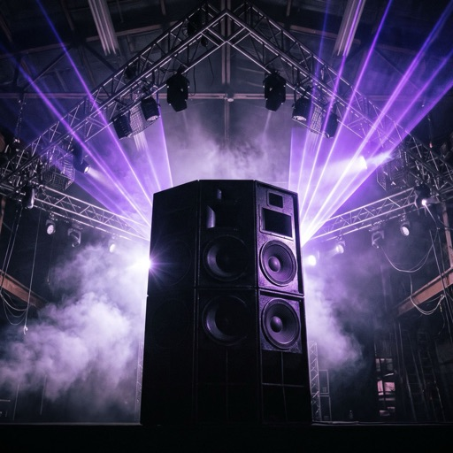 | 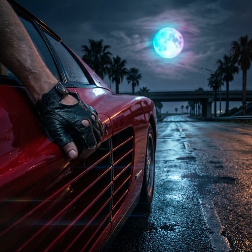 | 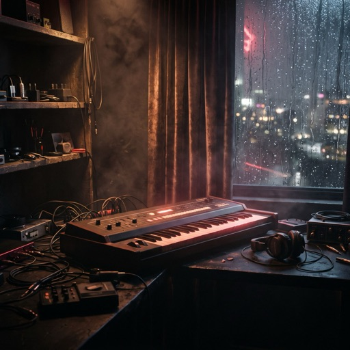 |
| **Main Stage** EDM · In the box | **Night Drive** Synthwave · Free download | **Velvet Hours** R&B · Neo-soul · Free download |
| A big punchy kick, a wide clap with a long room, supersaw chords, a bright pluck lead and a sub bass. | Dry 80s drum-machine kicks and hats, gated snares and toms, a tambourine, a machine cowbell and a pulse bass. | A soft, laid-back kick, finger snaps and rims, lush electric-piano chords, a round sub bass and a sung vocal. |

**More genre packs:** indie rock, house, techno, drum & bass, lo-fi, afrobeats and more are on the way. They show on Chop Shop's
start screen as Coming soon.

**Skill packs:** new sounds plus skills that Generate writes with. Skills are yours to keep, with any pack.
[See the skill packs →](https://lowdownsound.io/store)

## Bring your own samples

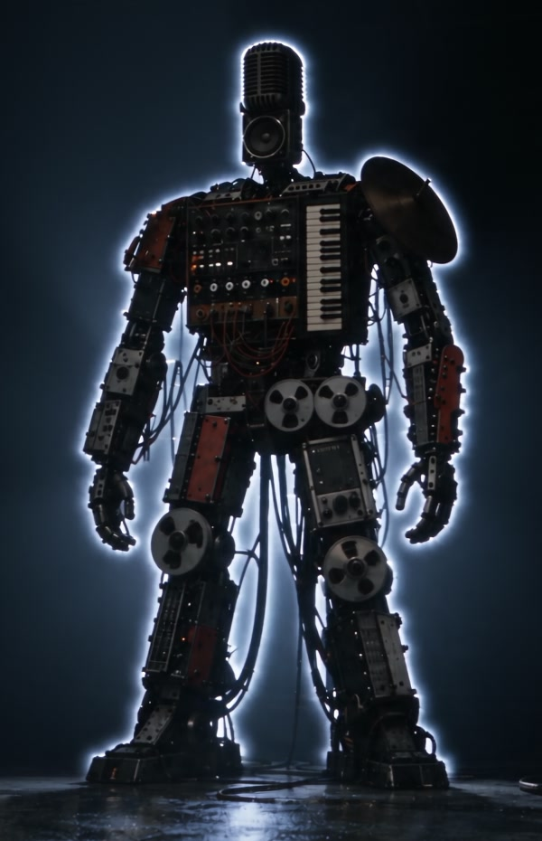

Any folder of samples becomes a pack: a library you bought, a folder of one-shots, your own recordings. Chop Shop sorts
it into kick, snare, hats, bass, music and vocals, and finds its songs.

Or open **Find samples**: listen through any folder on your Mac, keep the good ones, and make a song from the ones you
pick.

Glitchy, the shop's robot, walks you through it in the tour. Pick your parts, Generate, and keep what you like.

**Your samples stay on your Mac.** Nothing is uploaded, and your folder isn't changed.

> Bring your own samples. I'll pretend I made them. — Glitchy

 

## Install

1. **Get it.** Download `ChopShop-0.4.37.lunaaddon.zip` from the
   [latest release](https://github.com/garrettz/chop-shop/releases/latest) and unzip it.
2. **Install it in LUNA.** Save and close any open session first. Then double-click `Chop Shop.lunaaddon`, or drag it
   onto LUNA, and LUNA puts it in its Add Ons.
   - Installing with a session open makes LUNA swap it for a new empty "Untitled" session.
   - If your LUNA doesn't take the file, copy this repo's [`Chop Shop/`](Chop%20Shop) folder into
     `/Library/Application Support/Universal Audio/LUNA/Add Ons/` instead.
3. **Open it.** Open a session, then **Add Ons → Chop Shop**. On LUNA 3.1.2 or later it asks once which servers Chop
   Shop may reach: **Allow**, so the example packs can download.
4. **Take the tour.** On the start screen, Glitchy shows you round in a few minutes, with sound on. The tour is a
   sandbox: it doesn't touch your session.

**Updating:** install the new one the same way, then close the Chop Shop window and open it again.

[INSTALL.txt](INSTALL.txt) has the full notes: pads and controllers, API keys, and where to find the logs.

### What you need

- **LUNA** 3.1.1 or later, on macOS
- **Internet** only to download the example packs' songs and unlock skill packs
- **AI keys (optional):** your own ElevenLabs, Stable Audio or fal.ai key to generate sounds, and an Anthropic key to
  name tracks. Keys stay on your Mac and go only to their provider. None ships in this repo.

## Questions

<b>Does Chop Shop work without LUNA?</b>

No. It's a LUNA Add On: it runs in a window inside LUNA 3.1.1 or later, and LUNA plays everything it writes.

<b>What does it write into my session?</b>

Audio tracks named Chop 1, Chop 2… with a clip for every hit, plus LUNA plugins, automation, markers for the song's
parts, and the session's tempo and loop. Chop Shop only makes or opens a session when you click, and saves the open one
first.

<b>Are my samples uploaded anywhere?</b>

No. Your packs, sessions and samples live in Chop Shop's storage on your Mac. If you add an AI key, it stays on your Mac
and only goes to that provider.

<b>Can I edit the clips in LUNA?</b>

Mix, add plugins and bounce as usual. For the pattern itself, use Chop Shop: it treats its pattern as the master, so
clips you move by hand go back on its next write. ⌘ Z undoes its edits.

<b>How do I remove a track or change its sample?</b>

Select the track and click the folder key in its panel. The Sample menu swaps the sample (Find samples, From your Mac,
Drawer, your packs, or another sample in the session). **Delete track** at the bottom removes the track and its LUNA
track; it asks twice and can't be undone.

<b>What's in a skill pack?</b>

Sounds and skills. A skill is a producer trait, like "Drunk feel", that Generate writes with. You unlock a skill pack
with a serial, inside Chop Shop. [See the skill packs](https://lowdownsound.io/store).

<b>Where do the sounds come from?</b>

They're synthesized in code, made from public-domain (CC0) recordings, or, for the vocals, made with ElevenLabs. The
credits are inside the Add On.

<b>Something's wrong. What do I send?</b>

In Chop Shop, ⋯ → Functions → Download logs, then open an issue here with the file and what happened.

## What's in this repo

| Path | What it is |
|---|---|
| [`Chop Shop/`](Chop%20Shop) | The Add On itself: manifest, page, samples, tour and help. Copy this folder into LUNA's Add Ons folder. |
| [`INSTALL.txt`](INSTALL.txt) | The install notes that ship in the download |
| [`docs/media/`](docs/media) | Screenshots and pictures used on this page |
| [`docs/video/`](docs/video) | The example videos |

## Credits

Sounds: synthesized in code; CC0 recordings from VCSL, Karoryfer Samples and Freesound; vocals made with ElevenLabs.

Chop Shop is an independent LUNA Add On by LowdownSound; it is not made or endorsed by Universal Audio. LUNA is a
trademark of Universal Audio, Inc. © 2026 LowdownSound.
